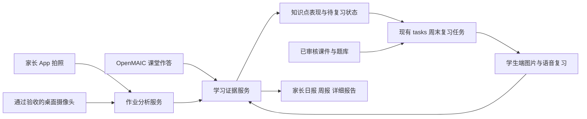

# 学习易错点、周末复习、拍照作业与课件复用实施方案

日期：2026-09-30。状态：实施设计，尚未执行业务代码修改、数据库迁移、设备拍摄或付费 AI 调用。

## 1. 产品决定

首版以家长 App 拍照、相册导入为作业采集入口；学生端接收订正任务、听讲解、完成变式练习和周末复习；家长 App 查看报告、设置复习日并处理少量识别疑点。

配套摄像头作为第二种采集入口，复用同一作业分析服务。完成桌面文档拍摄验收后，孩子可以在学生端点图片按钮，或在已授权作业模式中发出语音指令，自主提交作业。App 长期保留补拍、外出上传和设备离线时的入口。

选择依据：当前设备适配器有截图能力，但没有证明纸面题干、铅笔字、细小符号可稳定识别。首版 App 上传能先验证批改和学习流程；长期只让家长每天上传仍有负担，设备自主采集是后续减少家长操作的路径。两种采集方式共用 submissionId、题目记录、错题记录和报告。

不要求孩子在家长手机上长时间学习。暂未打开学生端时，订正任务保留在书包中，之后继续。

## 2. 同类产品参考与适用边界

以下为截至本次调研的官方产品或开发者发布说明；功能介绍不等于独立验证的准确率或学习效果，不引用“秒批”“提分”等营销数字作为本项目验收依据。

| 产品 | 官方说明中可确认的流程 | 采用的设计经验 |
| --- | --- | --- |
| [作业帮口算](https://www.zuoyebang.com/about) | 手机拍题、判断对错、解析、错题保存与打印 | 上传后形成可继续复习的题目记录 |
| [小猿 AI，原小猿口算](https://apps.apple.com/cn/app/id1325419855) | 开发者说明包含拍照批改、错误标注、讲解、错题归类和举一反三 | 作业检查、讲解、错题管理应连在一起 |
| [Photomath 扫描与编辑](https://support.google.com/photomath/answer/14333327?hl=en) | 手机对题拍摄、调整取景范围、修改识别出的算式；识别受光照等条件影响 | 必须让用户核对识别结果并纠正，不能只有“AI 的答案” |
| [Photomath 错误处理](https://support.google.com/photomath/answer/14332812?hl=en) | 错误解答先核对识别题目，再编辑题目或反馈解答问题 | 区分拍摄/识别错误与孩子实际答错 |
| [讯飞 AI 学家长 App](https://apps.apple.com/cn/app/id1570208252) | 查看设备学习动态、足迹/日报/周报，布置任务、查看孩子提交的作业成果 | 学生设备承担学习，家长手机承担管理、补充资料和报告 |
| [讯飞学习机](https://edu.iflytek.com/solution/family/learning-pad) | 官方页面介绍启发式辅导、错因分析、按学情练习，同时注明题型和实际识别条件限制 | 首版明确支持范围，设备拍摄与批改均须实测 |
| [学而思 T4 / T4 Pro 官方百科](https://xpad.xueersi.com/baike) | 本次查询到的官网索引区分拍摄桌面的前摄、拍人像上网课的前摄及后摄 | 纸面学习采集与人像看护有不同的拍摄要求 |

讯飞官网索引也列有自动翻转摄像头。两家硬件规格由本次查询返回的官方页面索引确认，未做设备实测；学而思页面动态正文未能直接解析，因此不将索引规格当成实时硬件验证。

手机 App 适合主动对准纸张、裁剪和补拍；专用学习硬件提供面向书桌的采集结构。是否采用现有配套摄像头，取决于实际摆位、对焦、整页覆盖和上传图质，不由“有摄像头”或像素数单独决定。

## 3. 当前项目基础及缺口

| 模块 | 已有基础 | 本方案补齐 |
| --- | --- | --- |
| 课堂作答 | 普通学习会话、渐进课程题目指纹、新版 textbookPlay 首答/提示/家长帮助/诊断 | 统一事件契约、稳定知识点和跨课易错点聚合 |
| 复习 | 单课间隔复习写入 tasks，学生首页可继续 | 周六或周日跨课组卷、约十分钟、恢复和顺延 |
| 家长报告 | 日报/周报已有课程证据、待巩固项；学习证据进入成长图谱 | 代表错题、知识点频次、前后变化、周末报告和作业报告 |
| 内容覆盖 | 新版完整活动注册表目前只有《天地人》 | 按课注册知识点、题库、图片、语音和真正的变式 |
| 拍照作业 | 通用视觉 Provider、设备截图适配边界 | App 采集、私有文件、分题识别、判题纠错、讲解与回流 |
| 课件复用 | 同生成标识防重、共享发布物、个人学习会话隔离 | 生成前按稳定课次检查已有内容，阻止跨 hash 的意外重做 |

代码落点：backend/content/textbook_journey.py、backend/services/textbook_classroom_service.py、backend/services/report_learning_summary.py、backend/services/textbook_preview_service.py、backend/content/textbook_preview.py、backend/integrations/camera_runtime/base.py、mobile/lib/src/features/profile/presentation/widgets/report_learning_section.dart。

## 4. 一套学习数据结构，接入多种来源

继续使用 Flutter → App Backend → AI Provider/Prompt/Policy → 设备适配器的边界。Student Web 和 OpenMAIC 通过后端记录学习，设备负责采集与口播，不直接判分或改成绩。

建议新增或整合以下数据实体，具体 SQL 在实施前结合现有表确认；不创建 daily_plan、daily_flow 等域。

| 实体 | 最小职责 |
| --- | --- |
| learning_question_refs | 题目不可变版本、题目指纹、知识点、题型、原题/变式组、图片/音频、预计时长、内容来源与发布状态 |
| learning_answer_events | 家庭/孩子、来源、会话、题目版本、作答、首答/重答、提示/帮助、时间、判定方法、结果；追加保存，不覆盖首答 |
| learning_error_observations | 对应作答的知识点、错因候选、依据、识别与判断置信度、待确认/确认/撤销状态 |
| learning_review_states | 孩子×知识点的近期表现、重复错误、提示依赖、独立证据、下次复习时间、待复习/观察中/已巩固 |
| learning_review_runs/items | 某周试卷快照、选题依据、题目版本、策略版本、进度、结束结果；关联 tasks |
| homework_submissions/pages/items | 家庭私有作业、页顺序、原图/裁剪、题目与答案识别版本、分析阶段、订正任务关联 |

现有普通课堂、textbookPlay、旧普通练习分别做适配器写入同一契约；照片分析和周末复习也写入它。事件追加与原作答事务衔接；跨进程处理用事务 outbox 和消费幂等，避免答题已成功但易错点丢失。

知识点 ID 与某一册教材目录分开，建立教材课次→知识点映射；概念发生实质变化才升级知识点定义。同名知识点不可直接跨学科、跨年级或跨版本合并。

证据规则：

- 区分首次独立、提示后答对、家长帮助、看讲解后重做、原题再现与新变式。
- 服务端记录题目发放、提示请求、展开讲解和答案公开事件，据此判定已知的帮助；答案请求中的客户端标志不能覆盖这些事实。线下帮助仍可能不可见，报告不把“未记录帮助”表述为确定无人辅导。
- 照片无法证明独立完成或准确作答时长；这些字段保持未知，不能默认“无帮助”。
- 识别不清、空白、未作答和实际答错分开记录；错因可以是候选，不凭一次错误断言“粗心”。
- 学习题目的表现不能直接推断专注、主动性、朗读或书写等未测能力。
- 历史数据只补入已有证据，不编造题目细节、帮助情况或过往每日快照。
- 识别/判题更正以 revision 和 supersedes 记录，撤销旧错误归因并更新后续计划；历史报告保留版本与更正说明，不静默改写。

## 5. 家长 App 拍照与作业分析

家长入口放在孩子学习区域及学习类任务详情的“检查作业”，支持拍照、相册和多页追加。上下文已有孩子与学科时直接带入；有歧义时再选择，避免每次填完整表单。

交互流程：

1. 拍摄时提示纸张边缘、模糊、反光和遮挡；支持旋转、裁剪、补拍、调整页顺序。
2. 上传后显示逐页处理进度。允许离开 App，回到同一提交继续查看，失败只重试失败阶段。
3. 原图上标出题目区域，区分“已检查”“需要订正”“待确认”“暂不支持”。默认只请家长处理有歧义的部分，不逐题手工审核。
4. 可修改分题框、题干和识别答案；重新分析受影响题目，避免整份作业重复付费。
5. 高置信且经校验的错误形成订正任务，学生在自己的学习端继续；可疑结果先待确认，不污染学习评分。
6. 家长查看简要结果和详细依据；完成订正后收到合并结果，不对每一页、每一步重复通知。

异步处理阶段：received → quality_check → segmenting → recognizing → checking → ready / needs_confirmation / failed。保存每阶段产物与请求凭据，断线后恢复。

分析顺序：分离题干、孩子原始作答、老师批注和后补答案 → 结构化识别 → 规则或工具核验 → AI 分步讲解 → 知识点及错因候选。不能仅看到老师的勾叉就认定原始作答结果。

Provider 继续通过已有抽象接入。版式/手写识别、计算核验、讲解使用不同职责的服务；Prompt、模型配置、判题规则和评测样本分别版本化。先用样本比较可用 Provider，再确定组合与成本，不因为已有某个视觉模型就默认它能可靠批改整页试卷。

首版先交付小学数学中明确支持的口算、竖式、选择、填空等题型白名单；复杂图形、开放论述、作文等显示暂不支持或仅提供建议。随后扩充语文/英语的可校验题型，再扩主观题。语文学科原有课堂复习可以与数学拍照试点同时运行。

讲解默认提示→孩子尝试→步骤说明→订正→同类变式。家长可查看完整解析；学生正在做作业时优先得到思路引导，作业完成后的订正可以展开完整解法。不能仅凭抄对原题就标记掌握。

## 6. 摄像头采集接入

现有 CameraSnapshot 仅包含 body/content_type。新增独立 documentCapture 能力声明，不把 snapshotAvailable 当成文档识别验收。

设备协议至少需要：requestId、deviceId、childId/taskId 的服务端绑定、拍摄时间、图片方向、原图尺寸、内容 hash、拍摄区域、质量结果、私有 artifactId 和成功/失败回执。原图与供 OCR 使用的裁剪图分别保存，不沿用看护摘要的低清压缩默认值。

调用顺序：检查登录角色及家庭/孩子/设备归属 → 检查作业分析授权和设备能力 → 发起一次拍摄 → 质量检查与孩子可理解的摆纸反馈 → 建立同一 homework submission → 进入第 5 节分析流程。

不持续上传看护视频作为批改输入。孩子通过学生端图片按钮或已授权语音发起，明确提示正在拍摄；设备离线、能力不足或画面不合格时提供 App 补拍。

硬件验收使用真实桌面摆位，覆盖 A4 作业、双页练习册、试卷分区拍摄、铅笔细字、橡皮修改、数学符号、纸张卷曲、手部遮挡、日夜光线和左右手书写。看清整页与看清细字需同时验证；大试卷允许分区拼接，不承诺一帧识别全部。

如果当前硬件达不到要求，先评估文档支架、拍摄区域引导或专门桌面镜头；硬件选型独立立项，不阻塞 App 作业分析与周末复习上线。

### 6.1 既有摄像头功能优先，作业采集不得干扰

这是上线硬条件，覆盖当前已启用的实时看护/视频、观察分析、任务提醒、语音对话及其他既有设备功能。当前截图、看护、云台、视频和播报共用设备运行时，尚未证明并发隔离；部分截图适配器失败后有配置恢复路径，不能直接假定调用 snapshot 没有副作用。

- 只允许从当前视野读取合格图像，或使用独立文档镜头。禁止为拍题转动、翻转看护镜头或要求用户挪走正在承担看护的设备；转回原位不能抵消中间的看护盲区。
- 新增受能力约束的安全文档采集路径，保留原 snapshot、视频和看护接口语义。作业流程不得停止/重启监控、重建视频连接、修改共享分辨率、编码、曝光、焦距、补光或夜视配置，也不得触发改变这些状态的自动恢复。
- 设备声明支持并通过并发验收后才开放该入口。单镜头或运行时无法保证原有功能时，返回能力不足或忙碌，转为 App 拍照；不能通过降低原看护质量完成拍题。
- 作业采集使用低优先级、限流、超时和可取消的队列；资源繁忙时延后或拒绝作业采集，优先保留原有看护、视频、通话及提醒。重试只恢复同一次请求，不持续抓拍。
- 截图完成立即释放本请求资源，OCR/批改在后端异步执行。失败、取消与超时只清理自己的临时资源，不能关闭共享流或重启设备。CPU、内存、网络和存储均设预算，不能以后台任务名义无限占用。
- 拍摄提示、摆纸指导和讲题音频进入已有语音仲裁边界；通话、老师讲解或既有高优先级提醒进行中时等待或改为画面提示，不截断正在播放的内容。

验收以同设备、同场景的原功能基线作对比：同时进行实时视频、看护分析、语音和任务提醒，检查拍摄前/中/后的视野、连接、配置、提醒送达以及资源/时延指标。正常、拥塞、拍摄失败、连续重试、取消、设备断线都要覆盖；存在由作业采集导致的中断或可感知退化则不开放该设备能力。可以单独关闭作业采集功能，原功能应继续正常运行。

## 7. 周末约十分钟复习

家长设置周六或周日、时段和是否提醒，默认北京时间；每周只安排一次。由后端调度生成任务，不能依赖家长打开 App 才创建。沿用 tasks 的调度、状态与提醒边界。

逻辑唯一键使用孩子＋周起始日＋任务类型；策略版本保存于试卷快照，不放进允许新建另一份周任务的唯一键。调度并发、重启和策略升级均复用本周任务，重新组卷须形成明确修订。

组卷规则：

- 优先近期反复出错、提示依赖和已到期知识点，再少量检验之前已经掌握的内容。
- 从已审核题库选择；用预计时长控制目标约十分钟，按年级、题型和个人节奏调整，不强制固定题数。首版以 8–12 分钟作为试用观察区间，可暂停或拆两段。
- 原题回顾属于教学，未见过的同知识点变式属于复测，分别计分；真正的变式不能只换题目 ID 或选项顺序。
- 没有错题时提供简短保持练习或休息，不为凑时长制造弱项；证据不足时明确说明。
- 题库不足时缩短任务、展示覆盖范围并提交后台内容缺口，不在学生点击开始时实时生成整套课程。
- 同周新上传作业默认进入下一轮；尚未开始的试卷需要更新时显式修订并保留来源截止时间。已开始试卷冻结题目版本。
- 中途退出保留当前题和进度，未答题不算错误；错过周末可顺延继续同一任务。
- 跨周最多展示一份待完成周复习：已开始的旧任务保留续做，暂不推第二份；未开始的旧任务可标记为被新安排替代，未巩固知识点合并到新周任务。跳过、取消和替代不算答错，调度补跑不追发多周试卷。报告分开记录任务所属周期与实际完成日期。

学生端通过现有书包/学习任务进入；OpenMAIC 承载微讲解与互动，复习页面复用现有学习控件，不另建独立 HTML。低年级用有意义的多图作答、匹配、拖动、预制 Qwen 老师语音和可重听按钮，沿用共享按钮尺寸、工具栏常显规则。

### 7.1 摄像头提醒与临时有事的处理

周末复习接入现有摄像头任务提醒能力，但增加仅作用于 weekend_review 的策略。当前任务运行时已有课堂提醒、延后提醒和逾期处理；不能直接把它的高频延后或到期 missed 路径当成本方案已实现，更不能修改全局策略影响原有任务。

现有等待课堂真实启动的识别依赖 learning_course_id；跨课复习应按 review_run_id 及服务端复习开始/完成事件接入，不能挂一个无关课程 ID 绕过自动启动。任务播报链还需补齐统一的声道忙、睡眠/勿扰和有效期校验，不能把聊天模块已有的限制当成任务播报已覆盖。

默认规则：

- 家长选定周六或周日的预约时段。家庭已开启语音、设备在线且当前允许播报时，预约时间温和提醒一次：“有一个大约十分钟的小复习，现在开始，还是晚一点？”提醒本身不启动测验。
- 不打断现有通话、课程讲解、看护播报，不在睡眠/勿扰或已知外出期间播报；无法确认适合播报时保留学生端入口或使用家长选择的 App 通知。不能为判断是否在家另开持续录像或把“没看到孩子”当成确定外出。
- 周复习默认无回应不重复口播；只有明确选择“稍后”或家长改期才建立新的提醒预约。周复习口播每日上限默认为两次，可关闭；改期不会绕过上限。
- 预约后默认 30 分钟仍未开始，记录为待安排；该窗口可配置。家长 App 最多合并提示一次，可改期或跳过。它不是十分钟测验的答题倒计时，也不据此计零分、扣积分或降低成长能力分。
- 摄像头离线、播放排队或未收到送达回执，分别记录为未播出/待送达；不得写成“孩子听到但不配合”。过期提醒恢复联网后不补播。
- 取消、改期、开始、完成、跳过或休假均使旧提醒失效。队列在真正播报前再次检查任务状态、预约 revision、勿扰和有效期，防止旧消息晚到。

| 情况 | 孩子/家长操作 | 系统行为 |
| --- | --- | --- |
| 想现在做 | 学生端点图片按钮或确认开始 | 打开原任务，以课堂真实开始事件计入进度；停止后续开始提醒 |
| 过一会儿做 | 孩子选“20 分钟后”，或家长选稍后 | 在家长允许的时段内延后同一任务，取消旧提醒；若超过允许时段，今天先不提醒，留待安排 |
| 周六有事，周日能做 | 家长选明天或指定日期时间 | 修改同一任务预约；保留试卷与已有进度，不重新生成课件或另发一份试卷 |
| 今天有事但还没定时间 | 孩子用语音/图标表达今天不做 | 暂停当天催促，记录待安排；家长可稍后指定时间，不要求立即处理 |
| 整个周末不能做 | 家长选“本周跳过”或改到工作日 | 跳过只结束本次安排，不计错误；错题证据保留供以后选题。改期继续同一任务 |
| 出游、生病或考试周等需要休息 | 家长暂停周复习至某日期 | 暂停期间不建立新周任务、不提醒、不累计缺考；到期恢复下一次正常安排，不追补暂停期间试卷 |
| 做了一半临时离开 | 暂停/退出 | 保存逐题进度，之后继续；暂停时间不计有效学习时长，未答题不算错 |
| 周末过去仍未做 | 无操作 | 报告显示“本周未参加/暂无复测结果”，保留待安排；按第 7 节跨周合并规则避免积压 |

周复习状态至少区分待开始、进行中、已暂停、待安排、已完成、本周跳过、被新安排替代；它们是学习任务的扩展状态/事件，不新增独立计划域。预约 revision 与试卷版本分开，改时间不改题。家长可跨日改期、跳过或暂停；学生只能在家长允许范围内开始、稍后或暂停当天，不能修改家庭规则。

对外“未参加”和“待安排”只描述安排状态，不推断学习能力、习惯或态度；跳过、休假和待安排也应从普通 missed 的负向“需要跟进”文案中排除。报告同时保留原所属周、改期原因（自愿填写）和实际完成日期；实际延迟复测间隔用于解释结果。

## 8. 家长详细报告

沿用现有日报、周报和成长图谱，增加可展开的知识点与题目依据。报告摘要先回答：哪里需要留意、是否改善、系统已安排什么、家长是否需要介入。

每个薄弱点展示：知识点名称、相关课次、证据来源与日期、有效题数、首次表现、提示/帮助、代表错题、孩子答案、讲解/订正记录、原题与新题复测变化、下次安排、待确认项。

“本周改善”只能比较口径一致的证据；旧题熟练和独立新题分开展示。分母小或证据不足时给出说明，不用虚假的高精度百分比掩盖样本不足。

家长建议最多突出一两件可执行的事，系统能独立处理的订正先交给学生端。复用已有辅导分钟记录，分别观察上传、疑点确认和实际辅导用时，未记录不当成零；不把课堂播放时间当作节省的家长时间。

## 9. 课件、题库和分析结果复用

内容与个人学习记录分层：共享层存审核后的原创课件、题目、插画、讲解与音频；家庭层存照片、手写答案、个人对话、作答和报告。私人作业素材不得自动提升为公共题库。

生成前按稳定课程身份锁定：教材版次＋科目/年级/册次＋稳定课次＋明确教学版本。目录修订通过映射指向已审核内容；不要让整份目录无关元数据变化直接决定重生成。

查找顺序：可兼容的已发布内容 → 已完成草稿 → 运行中任务 → 确实没有可用内容时申请生成。创建新教学版本需显式操作、说明差异和预算；提示词升级默认只影响未来新内容，不自动重做既有课件。

在生成前做唯一预留与并发保护，而不只在发布后查重。超时后先查询原任务、回执和保存结果，不盲目重新发送付费请求。图片、语音按内容、声音与模型版本复用。

照片分析在家庭/孩子授权范围内按图片 hash、裁剪版本、识别/分析版本复用阶段结果；判题与学生作答绑定，不能把其他孩子的答案结果当成本次批改。相似图片只提示可能重复，不凭感知 hash 自动合并不同作答。

记录每阶段 providerCallId、预算和实际消耗。重试次数、每份作业页数、单题分析上限通过配置约束；用实际试点数据制定额度，不承诺无限量 AI。

## 10. 拟新增 API 与代码落点

以下为拟议契约，不是已上线接口。遵守现有家长 v1 与学生 v2 的身份边界；请求不接受客户端自报正确答案或最终分数。

| 接口 | 契约要点 |
| --- | --- |
| POST /api/children/{childId}/homework-submissions | source、学科、幂等键；返回 submissionId 和私有上传凭据；设备采集关联受控 capture 请求 |
| POST /api/homework-submissions/{id}/analyze | 提交页资产及版本，返回异步状态；同版本重试复用任务 |
| GET /api/homework-submissions/{id} | 页级进度、支持范围、错误/待确认题和订正任务；只返回授权家庭数据 |
| PATCH /api/homework-submissions/{id}/items/{itemId} | 识别文本、分题框或原作答纠正，带 revision；冲突返回 409 |
| DELETE /api/homework-submissions/{id} | 删除原图、裁剪及派生个人内容，撤销相关证据；报告标记来源删除并按策略重算，不保留无依据的个人弱项 |
| PUT /api/children/{childId}/review-preferences | 周六/周日、时间、时区、允许时段、提醒开关/上限、pausedUntil 和 revision；家庭勿扰优先 |
| POST /api/learning/reviews/{id}/schedule-actions | 家长改期、本周跳过、暂停/恢复；appointmentRevision＋幂等键，复用原任务并使旧提醒失效 |
| GET /api/reports/learning/weaknesses | 按孩子/周期查询薄弱点、样本数和代表题；现有 daily/weekly 返回摘要引用 |
| GET /api/v2/student/learning/reviews/{id} | 只返回当前孩子的冻结试卷和进度；Student Web 代理保持现有 v2 认证边界 |
| POST /api/v2/student/learning/reviews/{id}/actions | 请求提示、展开讲解、下一题、暂停、受限稍后或暂停当天；服务端记录帮助和时间，检查家长规则；不接受客户端声明已完成 |
| POST /api/v2/student/learning/reviews/{id}/answers | 当前题、答案及幂等键；服务端根据已记录帮助与公开状态判题，答案仅在允许的反馈阶段公开 |
| POST /api/v2/student/learning/homework-captures | 仅为当前孩子已授权的作业任务发起采集；服务端解析绑定设备与授权，学生不能提交任意设备 ID 控制其他设备 |

设备采集采用独立 capability 与作业分析授权检查，不能直接把现有 GET camera/snapshot 的权限当成批改权限。设备 requestId、submissionId 与实际拍摄回执关联。

主要新增服务建议：learning_evidence_service、learning_review_service、homework_capture_service、homework_analysis_service、course_reuse_resolver；通过 repository 承担事务与幂等。策略放 backend/content，Prompt 放 backend/prompts，评测放 backend/tests/fixtures 与版本化 eval 配置。周复习单独定义提醒、预约、跨周与暂停策略，不改全局任务规则；设备侧扩展采集准入与语音仲裁，保持原设备协议兼容。

修改既有接入点：learning_service、textbook_classroom_service、report_learning_summary、task_scheduler_runner、textbook_preview_service；Flutter 新增作业采集/结果/识别纠正流程并扩展原报告；Student Web 接入订正和周末任务，OpenMAIC 原生变更纳入补丁序列与 lock manifest。

## 11. 实施阶段与验收

| 阶段 | 交付 | 通过条件 |
| --- | --- | --- |
| P0 基础与防重 | 稳定课程身份、生成前复用检查、事件/题目/知识点契约 | 同课重复点击、跨孩子使用、提示词变更、并发启动均不会意外重复生成；个人成绩隔离 |
| P1 课堂易错点＋周末＋报告 | 接通现有课堂事件；审核题库；周末任务与家长详细报告 | 至少两课的不同薄弱点能形成一份有依据的复习；调度重跑仅一份；退出续做；报告可追到题目 |
| P2 App 拍照试点 | 数学题型白名单、多页上传、异步判题、纠错、订正和回流 | 清晰/模糊、手写/印刷、老师批注、断网重试均有正确状态；照片题与课堂题汇入同一知识点 |
| P3 设备自主采集 | documentCapture、摆纸引导、一次拍摄回执、学生发起 | 真实桌面样本通过图质及批改验收；离线/他家/解绑设备拒绝或降级；不重复拍摄或计费 |
| P4 内容扩展和真实试用 | 扩展年级、科目、题型与变式池，优化讲解 | 按题型公布实测覆盖与错误情况；观察孩子自主完成、延迟复测及家长投入 |

P0 的课件防重与证据契约可并行；P1 形成软件闭环；P2 复用它接入纸面作业。设备拍摄可提前做离线能力评估，正式接入依赖 P2；未通过的硬件不影响软件交付。阶段交付按验收推进，具体工期在确定首批题型、模型和人力后估算。

验收不能只看接口 200 或生成了文字报告。必须包括：

- 三种来源能够合并同一知识点，未知和待确认不会进入错误分母。
- 知识点、题目、会话和报告全部校验家庭/孩子权限，学生不能提交自定分数。
- 同周调度并发、重启、补跑及策略升级不会生成重复任务；试卷中途版本不变化。
- 跨周补跑不会造成多份复习积压；服务端已知的提示/讲解记录不能被客户端漏传或篡改成独立作答。
- 周末任务提醒不自动开考；无回应不重复催；改期/跳过/开始/休假后旧提醒作废；离线恢复不补播过期语音。周末未参加不进入成绩或成长分数，预约时间不能充当实际开始时间。
- 单独开启、关闭和故障回退作业采集时，已有看护、视频、语音、提醒正常；不改变镜头视野或共享配置，不能通过暂停原功能来通过拍题验收。
- 反复做原题、看答案后改对、提示或成人帮助不能冒充首次独立掌握。
- 完成、未完成、无错题、题库不足、部分分析失败和设备离线均有完整界面状态。
- 对原图的纠正、撤回和删除可追溯到错题、复习与报告，不能留下一条失去依据的个人弱项。
- 一二年级遮住非目标文字后，孩子仍能听懂要求、分辨图片、作答和继续。
- 真实照片基准按年级、题型、书写、设备和光照分层；分别报告可处理覆盖率、识别错误、判题错误和待确认率，不能只报总准确率。
- 建议用至少 100 页、约 1000 题的授权或自制样本做首轮基准，保留独立验收集；高置信自动判错的误判率暂以不高于 1% 为试点目标，按样本量同时报告不确定性。该数值是待验证目标，不是当前能力承诺；不能靠把绝大多数题标成待确认来宣称达标。
- 用真实试用记录家长上传/确认/辅导时间、孩子能否独立订正、周末任务时长和新变式延迟表现；据此判断减负效果。

数据库结构调整前确认目标连接、备份和恢复办法，在隔离副本验证后按项目流程执行；本方案不授权或执行任何现有库迁移。旧记录与既有报告保留兼容读取，按功能开关逐步开放。

## 12. 本轮核验范围

本方案依据当前仓库（含未提交修改）、前一轮三项需求审计，以及本轮官方网页调研。前一轮 52 项定向后端测试通过，但不能作为拍照准确率、摄像头文档能力或周末全流程已完成的证明。

本方案目前仅新增并修订文档；未运行照片批改、设备采集、付费模型调用、数据库迁移或上线操作。2026-09-30 补充第 6.1 节摄像头兼容硬约束和第 7.1 节复习提醒、改期、跳过及暂停规则；这些规则仍待实施与设备实测。
